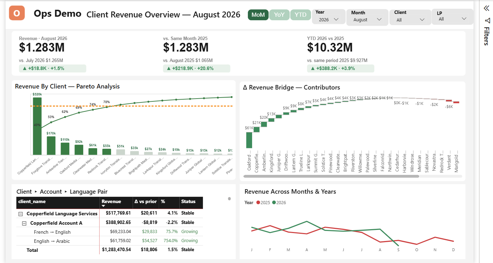
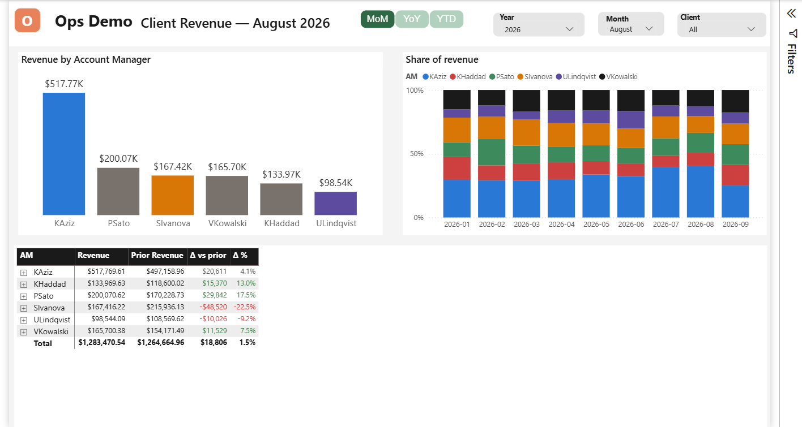
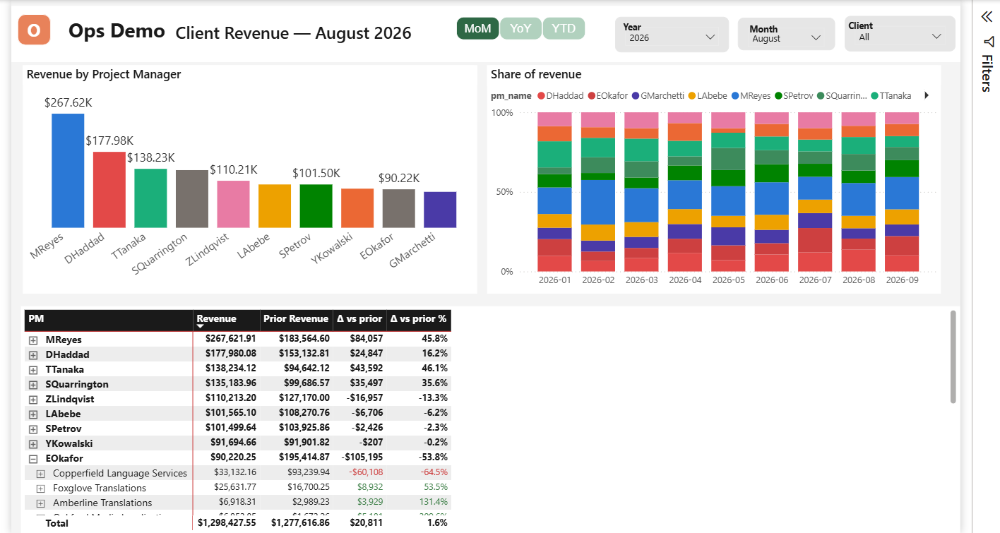
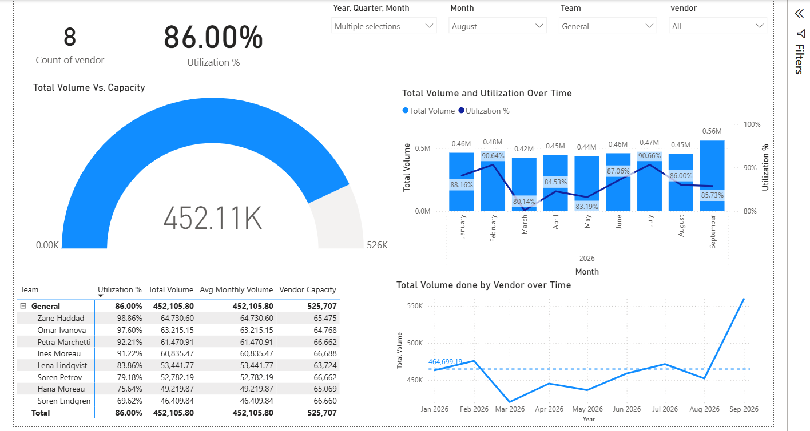

# Ops Performance Analytics: demo

A working, fully synthetic copy of a reporting pipeline I built and run at MidLocalize, a
localization services company. A Python ETL enriches monthly exports from the company's
translation management system (XTRF), recovers revenue those exports silently drop, and feeds
two Power BI reports: client revenue with AM and PM performance, and in-house linguist
utilization.

Every name and number in this repository is generated. No company data is included.



## The problem

- Each month, account managers sent scattered Excel reports, and someone consolidated them by
  hand over about a working week.
- There were no metrics at all for project manager performance or for in-house linguist
  (production) performance.
- Revenue was silently missing from the reports, and nobody could see it:
  - **Late-arriving jobs.** Each month's export is a snapshot taken a few days after the month
    closes. A job finalised after that snapshot never reached any month's file.
  - **Orphan projects.** Some projects booked revenue and were closed without a single job
    being created, so they never appeared in the jobs export at all.

## What I built


- **An ETL** that turns each month's snapshot into one enriched file. It converts EUR to USD
  at each row's own month's rate. Every run re-sweeps the year to date for late jobs and
  orphan projects and appends what no earlier file holds.
- **Two Power BI reports** on top of it. Management follows client and account revenue
  (month over month, year over year, year to date), each AM's and PM's book, and each
  linguist's utilization against capacity, all in one place.
- **An LLM agent that runs the monthly close.** It fetches the data and runs the ETL. After a
  manual refresh in Power BI, it queries the model over MCP and writes the narrative report.

In production, the enrichment that used to take about a working week is a measured agent
run of about 23 minutes. Its first runs recovered 637 job rows and 110 orphan project rows
that had been missing from the reports.

## What this repository proves

The generator imitates the source system's exports and **plants** both defects, recording
each one. The ETL then runs month by month, exactly as it does in production, and
`run_demo.py` checks that what was planted is what came back:

```
python run_demo.py --seed 42
```

| | Planted | Recovered |
|---|---:|---:|
| Late-arriving jobs | 320 | 320 |
| Orphan projects | 110 | 110 |

It also proves the defects were real and not just reconcilable:

- All 320 late jobs are absent from their own month's export, and each one is recovered by a
  later month's run.
- 69 orphans are caught in their own month's run and 41 by a later year-to-date sweep. Those
  41 surfaced after their month's snapshot was taken.
- Every orphan has zero job rows in the final snapshot.
- Every planted row comes back exactly once, in its own month, at its own month's USD amount.
- Every job in the source appears exactly once in the output: nothing is lost or duplicated.

None are planted in December or in the last month of the period, because no later run in the
same year exists to recover them. See [known limitations](docs/known-limitations.md).

## Run it

Python 3.12 or later. The ETL and the generator use only the standard library.

```
python run_demo.py --seed 42        # generate 21 months of exports, run the ETL, reconcile
pip install pytest && pytest -q     # determinism, idempotency, FX, header and edge-case tests
```

The same seed gives byte-identical output. The data lands in `out/demo/`:

- `data/snapshots/<month>/`: what the source system would export that month.
- `jobs/`: the enriched monthly files that Power BI reads.
- `data/utilization/`: the linguist trackers and exports.

### Open the reports

1. Run the demo once, so `out/demo/` exists.
2. Open `powerbi/Clients Revenue Report.pbip` or `powerbi/In-house Utilization.pbip` in
   Power BI Desktop.
3. The models read from the `DataRoot` parameter, which defaults to
   `C:\ops-performance-analytics-demo\out\demo`. If you cloned somewhere else, set it under
   **Transform data → Edit parameters**.
4. Click **Refresh**.

| AM performance | PM performance |
|---|---|
|  |  |



## What the synthetic data looks like

- January 2025 to September 2026.
- 40 clients with Pareto-shaped revenue, plus growing, declining, churned and new clients.
- 6 AMs, 10 PMs, 60 freelance vendors and 12 in-house linguists, about 1,000 jobs a month,
  and a linguist capacity table that changes in September 2026.
- Late jobs cluster on two clients and one PM, as they do in production, where one PM booked
  work retroactively.
- All names come from fixed fictional word lists.

## Repository layout

| Path | What it is |
|---|---|
| `generator/` | Synthetic XTRF-style exports, with the planted defects recorded in `planted.json` |
| `etl/enrich.py` | The trimmed offline ETL: header detection, own-month FX, orphan and late-job recovery |
| `run_demo.py` | End-to-end run plus the planted-versus-recovered reconciliation |
| `tests/` | Reconciliation, determinism, idempotent re-runs, cross-year, stale-deadline and utilization tests |
| `powerbi/` | The two Power BI projects (PBIP), pointed at the synthetic data |
| `docs/known-limitations.md` | Behaviours inherited from production that the demo does not exercise |

## How the demo differs from production

- **No API calls.** The ETL reads snapshot folders instead of the live system, and FX rates
  come from a local CSV.
- **The Power BI models are the production definitions with synthetic names.** The client,
  account, AM, team and exclusion rules are regenerated from the synthetic world, and the
  folder paths go through `DataRoot`.
- **Some production pages are left out**: a volume table and its pages that come from a source
  the generator does not produce, and a few detail pages.
- **The AM and PM matrices carry the Overview's growth colours.**

## License

MIT. See [LICENSE](LICENSE).
